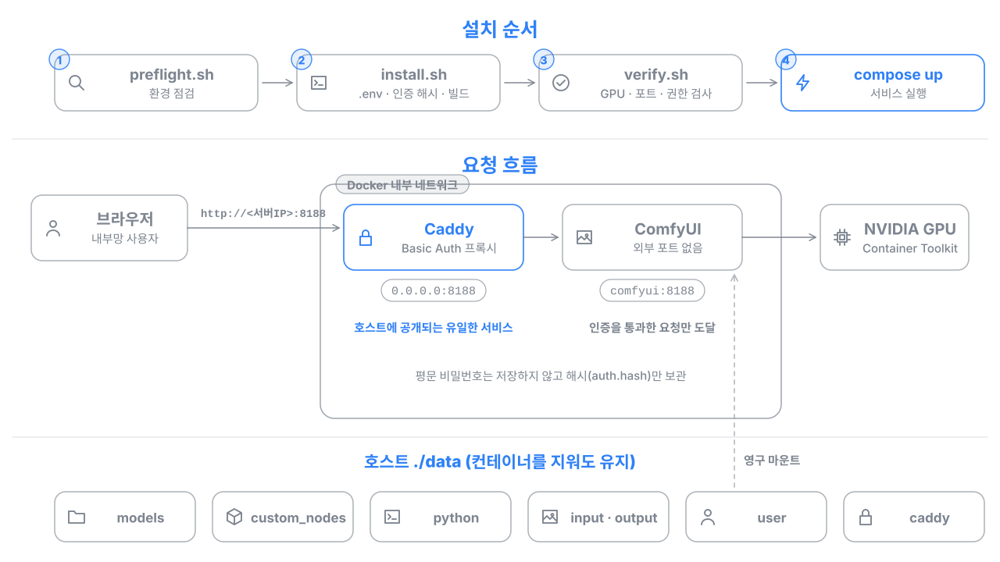
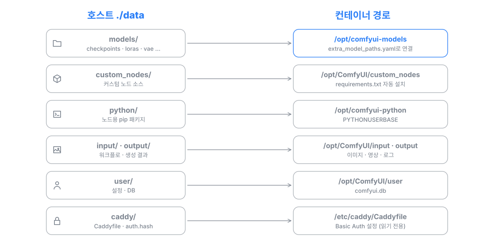

# ComfyUI Docker Installer

NVIDIA GPU 서버에 ComfyUI를 Docker로 설치하는 패키지입니다. Caddy Basic Auth를 거쳐서만 접속하게 하고, 모델과 커스텀 노드, 생성 결과를 컨테이너 밖 `./data`에 보존합니다. 설치, 검증, 삭제까지 스크립트로 재현할 수 있습니다.



## 주요 특징

- **인증 프록시 뒤에 배치**: 호스트에 공개되는 서비스는 Caddy 하나이고, ComfyUI는 Docker 내부 네트워크에만 둡니다.
- **비밀번호를 남기지 않는 설치**: 설치 시 Basic Auth 해시만 생성하고, 평문 비밀번호는 저장소나 `.env`에 기록하지 않습니다.
- **데이터 보존**: 모델, 입력, 출력, 커스텀 노드, 사용자 설정, Python 패키지를 `./data`에 마운트해 이미지를 다시 빌드해도 유지합니다.
- **권한 문제 예방**: Linux에서는 현재 사용자의 UID/GID를 감지해 컨테이너가 만든 파일의 소유권 문제를 막습니다.
- **설치 후 자동 검증**: `verify.sh`가 GPU 인식, 인증 동작, 포트 노출, 데이터 폴더 권한을 한 번에 확인합니다.
- **Windows 지원**: Docker Desktop에서도 같은 compose 구성을 사용합니다.

## 빠른 설치

### Linux 서버

```bash
git clone https://github.com/NAMUORI00/comfyui-docker-installer.git
cd comfyui-docker-installer
scripts/preflight.sh
scripts/install.sh --apply-runtime-fix
scripts/install.sh --start
```

Docker의 NVIDIA runtime이 이미 설정되어 있으면 `--apply-runtime-fix`는 생략합니다. 설치가 끝나면 `http://<서버 IP>:8188`로 접속해 설치 때 만든 계정으로 로그인합니다. 기본 사용자명은 `admin`이며 `CADDY_AUTH_USER`로 바꿀 수 있습니다.

자동화 환경에서는 비밀번호를 일회성 환경변수로만 넘깁니다.

```bash
CADDY_AUTH_PASSWORD='change-me' scripts/install.sh --start
```

### Windows PowerShell

```powershell
cd comfyui-docker-installer
.\scripts\install.ps1 -SkipBuild
docker compose build --pull
.\scripts\verify.ps1
docker compose up -d
```

## 데이터 보존 구조

컨테이너를 지우거나 이미지를 다시 빌드해도 사용자 파일은 `./data`에 남습니다. `extra_model_paths.yaml`이 모델 폴더를 `/opt/comfyui-models`로 연결하기 때문에 ComfyUI 기본 모델 폴더를 덮어쓰지 않습니다.



## 커스텀 노드 설치

노드 소스를 `data/custom_nodes`에 넣은 뒤 의존성을 설치합니다. 패키지는 이미지가 아니라 `data/python`에 저장됩니다.

```bash
scripts/install-custom-node-deps.sh            # Windows: .\scripts\install-custom-node-deps.ps1
scripts/install-custom-node-deps.sh --reset-python   # 의존성 충돌 시 초기화 후 재설치
```

신뢰할 수 있는 커스텀 노드의 요구사항만 설치하세요.

## 운영 명령

```bash
scripts/verify.sh                                    # 상태 점검
scripts/uninstall.sh                                 # 중지 (데이터 보존)
scripts/uninstall.sh --remove-image                  # 로컬 이미지까지 삭제
CONFIRM_REMOVE_DATA=yes scripts/uninstall.sh --remove-data   # 데이터까지 삭제
```

## 환경 변수

기본값은 `.env.example`에 있습니다.

```dotenv
COMFYUI_DATA_DIR=./data
COMFYUI_BIND_HOST=0.0.0.0
COMFYUI_HOST_PORT=8188
COMFYUI_REF=master
CADDY_AUTH_USER=admin
```

재현 가능한 빌드가 필요하면 `COMFYUI_REF`를 ComfyUI 태그나 커밋 SHA로 고정합니다.

## 보안 메모

기본 구성은 내부망용 HTTP와 Basic Auth입니다. 접근 제어는 되지만 평문 HTTP에서는 인증 정보가 암호화되지 않으므로, 외부에 노출하려면 HTTPS, VPN, SSO 같은 계층을 추가해야 합니다.

## 검증 환경

| 항목 | 버전 |
| --- | --- |
| OS | Ubuntu 22.04 |
| GPU | NVIDIA RTX A6000 × 3 |
| NVIDIA driver | 535.261.03 |
| Docker / Compose | 24.0.2 / v2.18.1 |
| NVIDIA Container Toolkit | 1.17.8 |

## 문서

- [운영 가이드 (네트워크, 검증, 실패 기준, 롤백)](docs/operations.md)
- [호환성 (이미지 선택 기준, CUDA 버전)](docs/compatibility.md)
